# FLYERS STOCK — CORESAN

40 flyers de productos nuevos (no están en el catálogo actual), **sin etiquetas de oferta ni de fiestas**. Quedan disponibles para cuando salgan a producción.

- **Galería web (celular / PC):** `flyers-stock/index.html` — en el sitio: https://catalogo-coresan.vercel.app/flyers-stock/ (una vez que esté en `main`).
- **PNG listos para publicar (1080×1920, formato historia):** carpeta [`png/`](png/).
- **Editar textos, agregar marca o foto real:** `flyers.js`, y después `node flyers-stock/export.js` para regenerar los PNG.

| Código | Producto | Categoría | Presentación | Venta |
|---|---|---|---|---|
| STK-01 | Arroz Largo Fino | Almacén | Bolsa 1 kg | Bulto x 10 u. |
| STK-02 | Arroz Parboil | Almacén | Bolsa 1 kg | Bulto x 10 u. |
| STK-03 | Harina 000 | Almacén | Paquete 1 kg | Bulto x 10 u. |
| STK-04 | Harina 0000 | Almacén | Paquete 1 kg | Bulto x 10 u. |
| STK-05 | Harina Leudante | Almacén | Paquete 1 kg | Bulto x 10 u. |
| STK-06 | Polenta Instantánea | Almacén | Paquete 500 g | Bulto x 20 u. |
| STK-07 | Aceite de Oliva | Almacén | Botella 500 ml | Caja x 12 u. |
| STK-08 | Vinagre de Alcohol | Almacén | Botella 1 L | Caja x 12 u. |
| STK-09 | Lentejas | Legumbres | Paquete 400 g | Bulto x 20 u. |
| STK-10 | Porotos Alubia | Legumbres | Paquete 400 g | Bulto x 20 u. |
| STK-11 | Garbanzos | Legumbres | Paquete 400 g | Bulto x 20 u. |
| STK-12 | Arvejas Partidas | Legumbres | Paquete 400 g | Bulto x 20 u. |
| STK-13 | Fideos Moñito | Pastas | Paquete 500 g | Bulto x 20 u. |
| STK-14 | Fideos Cabello de Ángel | Pastas | Paquete 500 g | Bulto x 20 u. |
| STK-15 | Fideos Munición | Pastas | Paquete 500 g | Bulto x 20 u. |
| STK-16 | Fideos Ñoquis | Pastas | Paquete 500 g | Bulto x 20 u. |
| STK-17 | Puré de Tomate | Conservas | Caja 520 g | Caja x 24 u. |
| STK-18 | Tomate Perita | Conservas | Lata 400 g | Caja x 24 u. |
| STK-19 | Choclo Amarillo | Conservas | Lata 300 g | Caja x 24 u. |
| STK-20 | Arvejas en Lata | Conservas | Lata 300 g | Caja x 24 u. |
| STK-21 | Café Molido | Desayuno | Paquete 500 g | Bulto x 12 u. |
| STK-22 | Cacao en Polvo | Desayuno | Pote 360 g | Caja x 12 u. |
| STK-23 | Té en Saquitos | Desayuno | Caja x 50 saquitos | Caja x 24 u. |
| STK-24 | Mate Cocido | Desayuno | Caja x 50 saquitos | Caja x 24 u. |
| STK-25 | Dulce de Leche | Desayuno | Pote 400 g | Caja x 24 u. |
| STK-26 | Mermelada de Durazno | Desayuno | Frasco 454 g | Caja x 12 u. |
| STK-27 | Leche en Polvo | Desayuno | Paquete 800 g | Caja x 12 u. |
| STK-28 | Galletitas de Agua | Desayuno | Paquete 3 x 100 g | Caja x 20 u. |
| STK-29 | Comino Molido | Condimentos | Sachet 25 g | Caja mayorista |
| STK-30 | Pimentón Dulce | Condimentos | Sachet 25 g | Caja mayorista |
| STK-31 | Nuez Moscada | Condimentos | Sachet 25 g | Caja mayorista |
| STK-32 | Canela Molida | Condimentos | Sachet 25 g | Caja mayorista |
| STK-33 | Laurel en Hojas | Condimentos | Sachet 10 g | Caja mayorista |
| STK-34 | Cúrcuma | Condimentos | Sachet 25 g | Caja mayorista |
| STK-35 | Adobo para Pizza | Condimentos | Sachet 25 g | Caja mayorista |
| STK-36 | Perejil Deshidratado | Condimentos | Sachet 25 g | Caja mayorista |
| STK-37 | Yerba Despalada | Yerbas | Paquete 1 kg | Bulto x 10 u. |
| STK-38 | Yerba Compuesta | Yerbas | Paquete 500 g | Bulto x 20 u. |
| STK-39 | Maní Salado | Snacks | Bolsa 500 g | Bulto x 12 u. |
| STK-40 | Vermut Rosso | Bebidas | Botella 1 L | Caja x 6 u. |

## Vista previa

<a href="png/STK-01.png">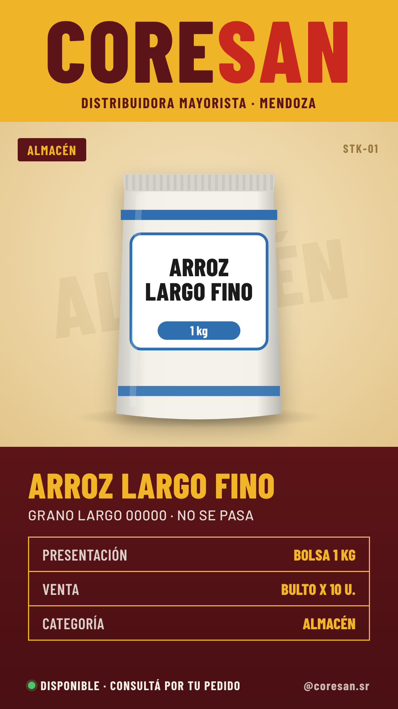</a>
<a href="png/STK-02.png">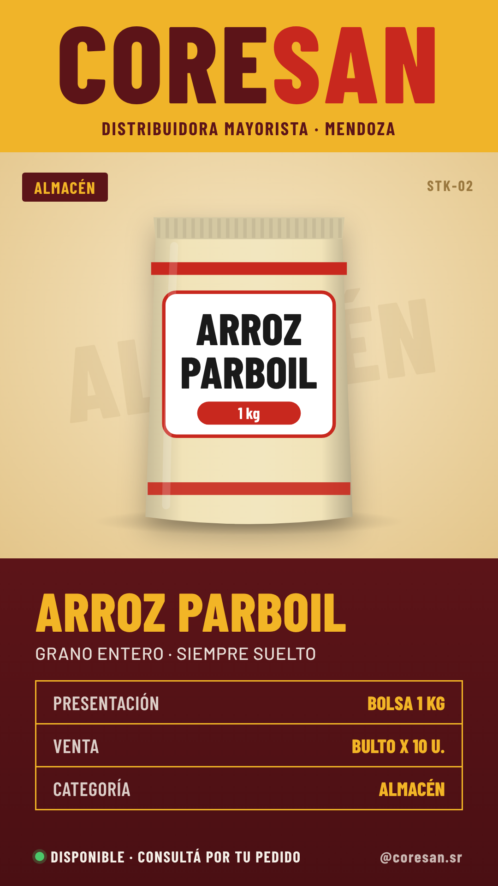</a>
<a href="png/STK-03.png">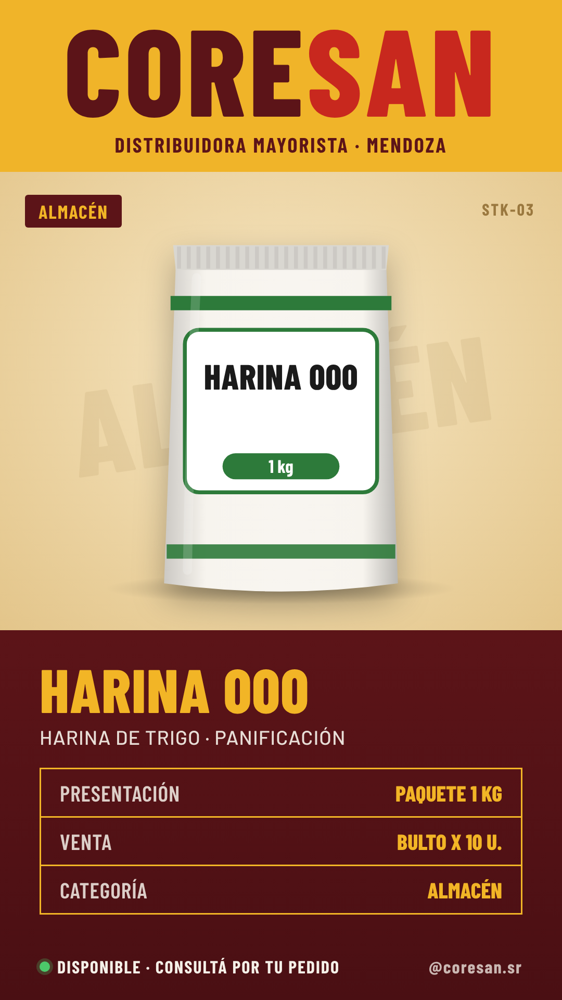</a>

<a href="png/STK-07.png">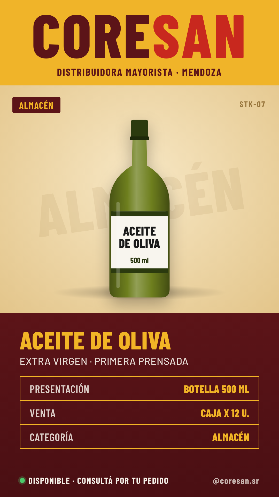</a>
<a href="png/STK-08.png">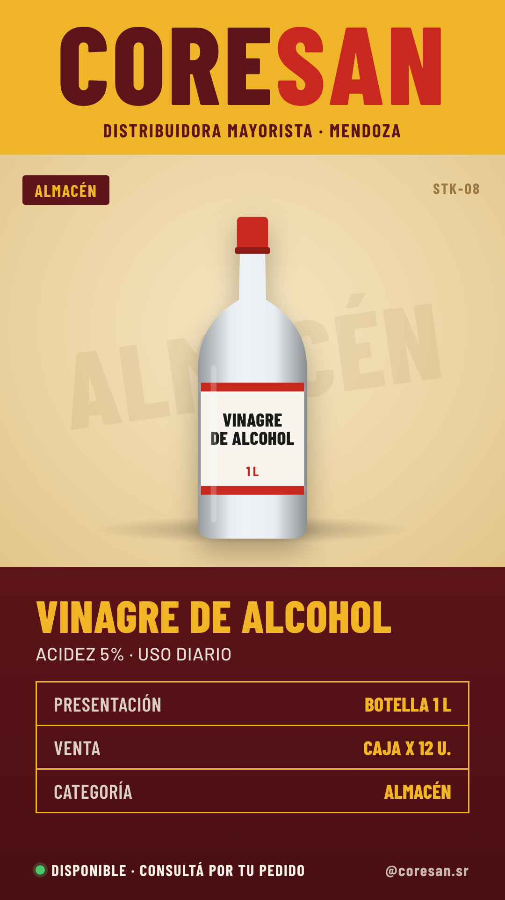</a>
<a href="png/STK-09.png">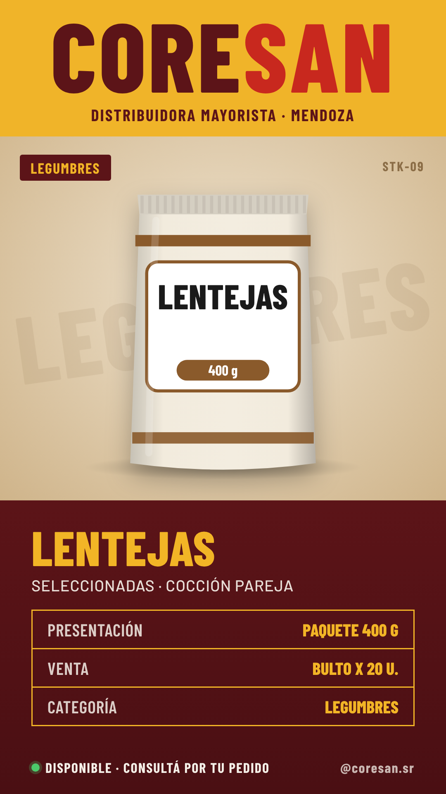</a>

<a href="png/STK-11.png">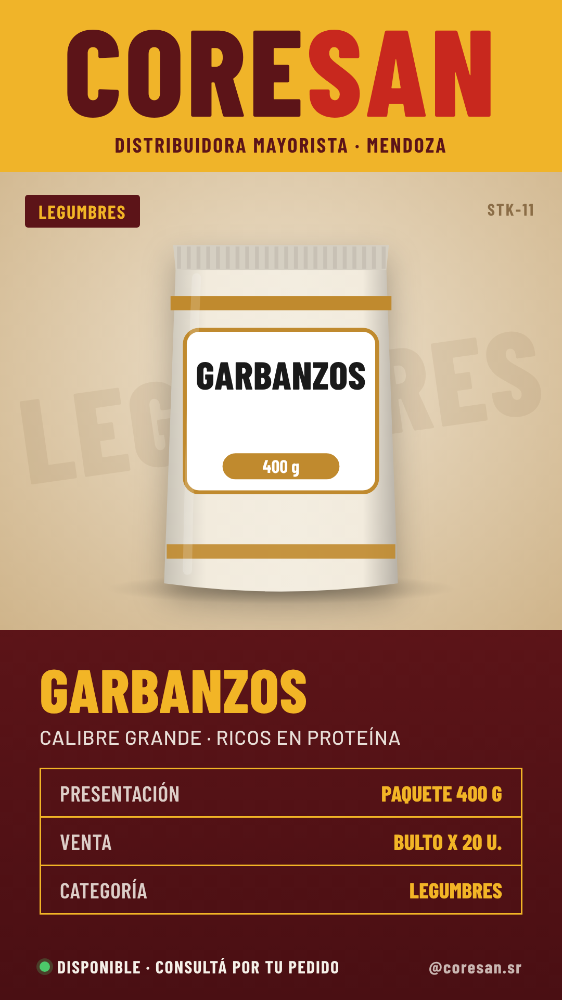</a>
<a href="png/STK-12.png">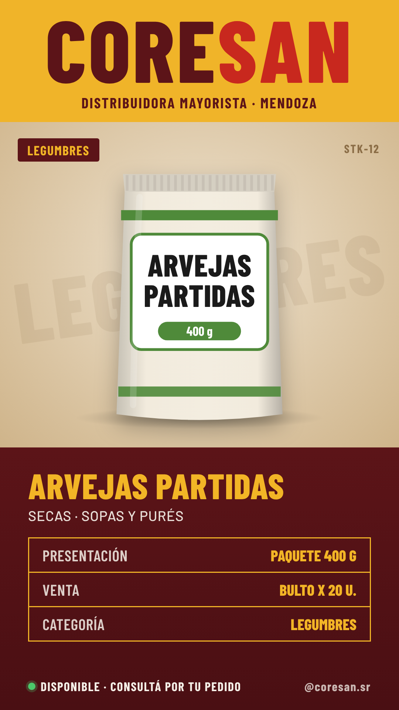</a>

<a href="png/STK-14.png">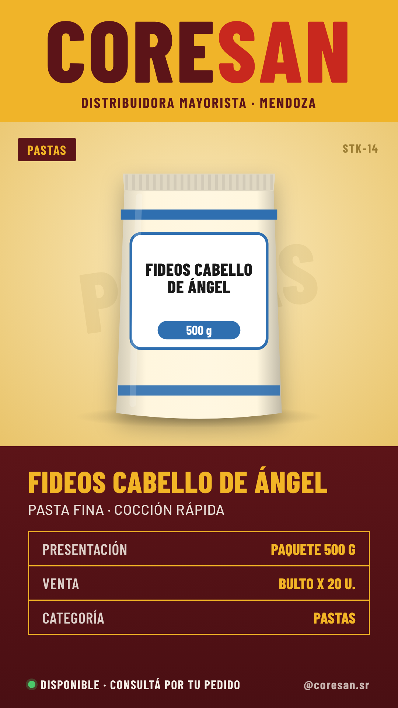</a>
<a href="png/STK-15.png">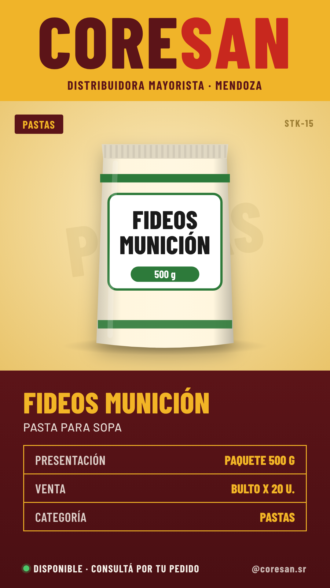</a>

<a href="png/STK-17.png">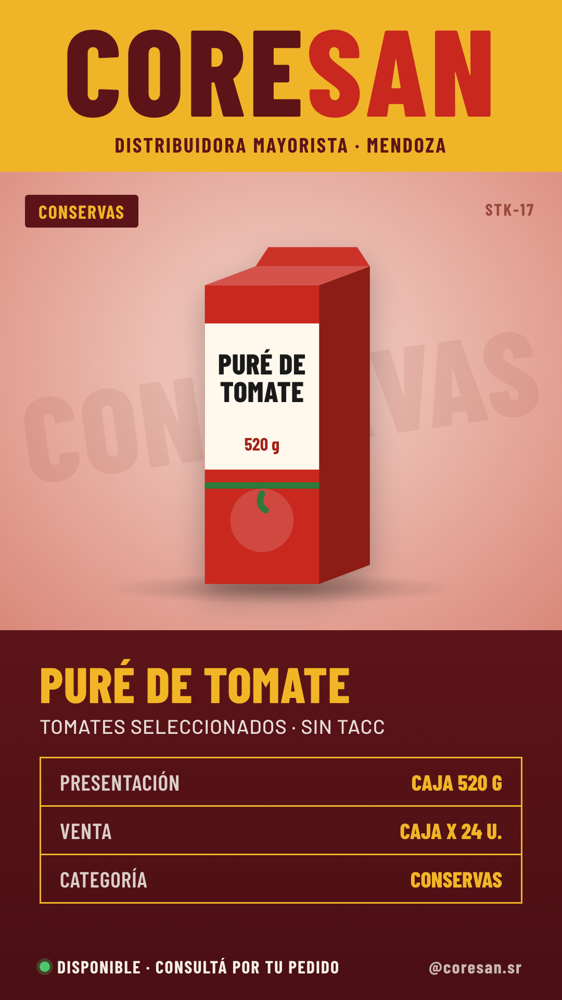</a>

<a href="png/STK-21.png">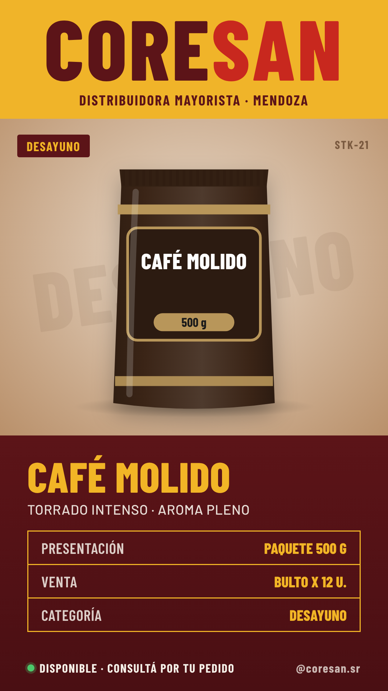</a>

<a href="png/STK-23.png">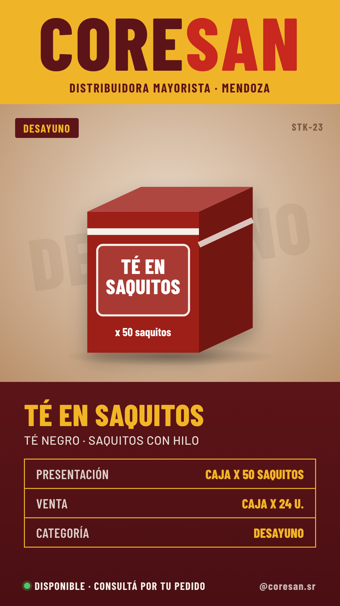</a>

<a href="png/STK-25.png">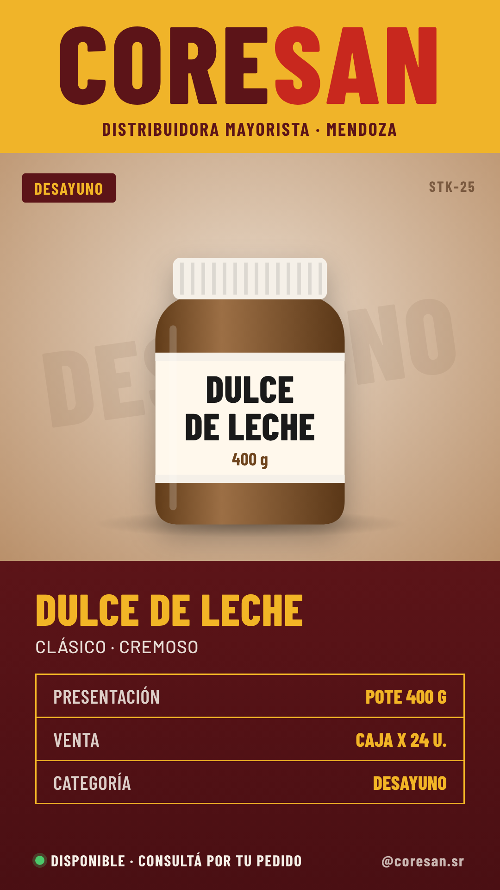</a>
<a href="png/STK-26.png">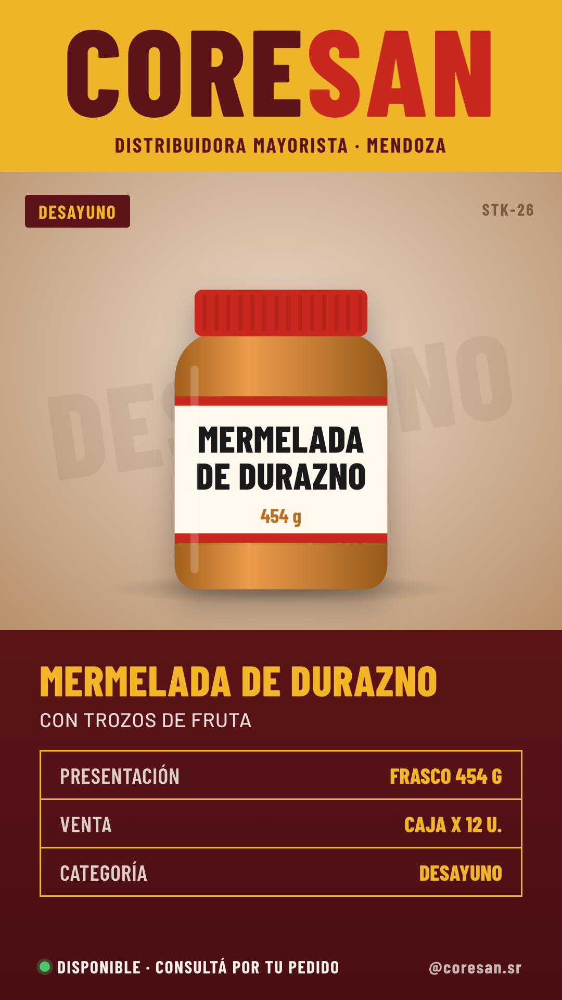</a>

<a href="png/STK-29.png">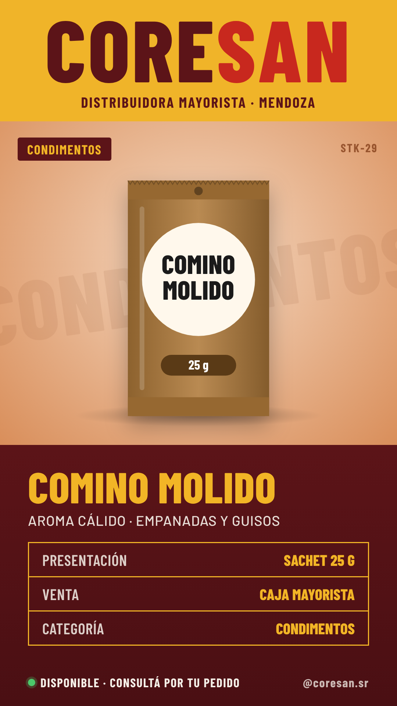</a>
<a href="png/STK-30.png">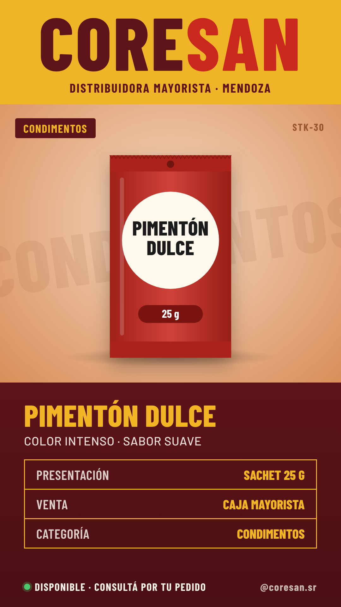</a>

<a href="png/STK-35.png">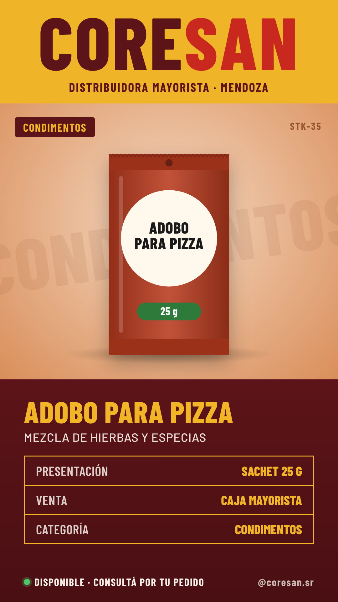</a>

